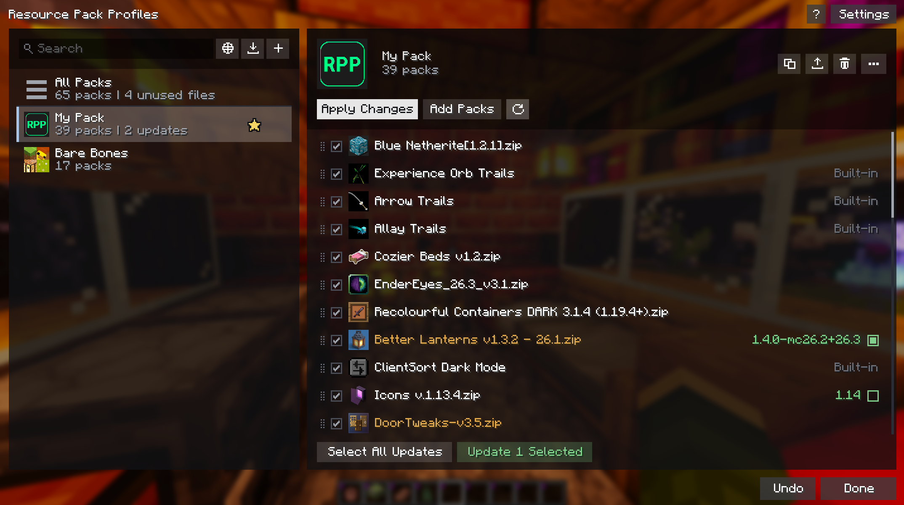

# Resource Pack Profiles

[](https://github.com/ZephByte/ResourcePackProfiles/releases/latest)
[](https://fabricmc.net/)
[](https://modrinth.com/mod/resource-pack-profiles)
[](https://www.curseforge.com/minecraft/mc-mods/resource-pack-profiles)
[](LICENSE)

A client-side Fabric mod for managing resource packs. Save named load-order profiles and switch between them in seconds, keep packs up to date from Modrinth, and find new ones without leaving the game.

---



---

## Features

- **One screen:** profiles on the left, the selected profile's packs and actions on the right. No separate edit screen.
- **Save and apply:** save your current packs as a profile with one click, and apply any profile without a restart.
- **Edit in place:** add, remove, and drag to reorder packs. Changes save as you make them, with an undo for the last one.
- **Select several packs:** Ctrl+click and Shift+click work like a file browser, so you can add, remove, switch off, move, check, or trash many packs at once.
- **Search:** filter profiles by name or by the packs they contain.
- **Favorites:** star profiles to pin them to the top of the list.
- **Custom icons:** set a PNG, JPEG, or WebP image for any profile. Profiles without one get an icon built from their packs' art.
- **Import and export:** share profiles as `.rpprofile` files, or drop them onto the screen to import. Dropping a `.zip` installs it as a resource pack.
- **Switch packs off:** untick a pack to skip it in a profile without losing its place in the load order.
- **All Packs view:** see every installed pack and how many profiles use it. Unused packs can be moved to a trash folder, which you can undo until you empty the trash.
- **Missing packs:** profiles that reference packs you don't have are flagged, and can still be applied without them. Importing a profile offers to download the missing packs from Modrinth, and a **Download N Missing** button does the same later. If the exact version has been removed from Modrinth, click the arrow on the missing pack to pick another version. This works for packs the sharer had from Modrinth, as long as their copy of the mod recorded where each pack came from (profiles exported by older versions don't include this).
- **Browse Modrinth:** search Modrinth's resource packs from inside the game, filter by category, resolution and game version, and install any version. Opened from a profile, a pack can be installed and added to it in one click.
- **Compatibility warnings:** packs made for an older or newer version of Minecraft are flagged.
- **Automatic switching (optional):** bind a profile to a world or server and it is applied when you join. Nothing switches automatically unless you set it up.
- **Update checker:** check a single pack, a profile, or every installed pack for newer versions on Modrinth. Updating switches the profile to the new file and keeps the old one, so other profiles keep working and you can switch back. A version list lets you pick any version of a pack.
- **Accessibility:** the profile and pack lists use Minecraft's native widgets, so they support keyboard navigation and screen readers.

---

## Download

- **[Modrinth](https://modrinth.com/mod/resource-pack-profiles)** (recommended)
- **[GitHub Releases](https://github.com/ZephByte/ResourcePackProfiles/releases)**

---

## Installation

1. Install [Fabric Loader](https://fabricmc.net/) for your Minecraft version.
2. Install [Fabric API](https://modrinth.com/mod/fabric-api).
3. Install [Fabric Language Kotlin](https://modrinth.com/mod/fabric-language-kotlin).
4. Drop the mod `.jar` into your `.minecraft/mods` folder.
5. (Optional) Install [Mod Menu](https://modrinth.com/mod/modmenu) to open the profiles screen from the mods list.

Client-side only. No server installation is needed.

---

## Compatibility

| Minecraft | Fabric Loader | Fabric API | Fabric Language Kotlin | Mod Menu *(optional)* |
|---|---|---|---|---|
| `26.3` | `0.19.5+` | `0.161.0+26.3` | `1.14.1+kotlin.2.4.20` | `21.0.0-beta.1` |
| `26.2` | `0.19.3+` | `0.152.2+26.2` | `1.13.12+kotlin.2.4.0` | `20.0.0-beta.3` |
| `26.1` to `26.1.2` | `0.19.3+` | `0.145.1+26.1` | `1.13.12+kotlin.2.4.0` | `18.0.0-beta.1` |

---

## Usage

**Options > Resource Packs** opens the **Resource Pack Profiles** screen in place of the vanilla one. It is also available via [Mod Menu](https://modrinth.com/mod/modmenu).

To keep the vanilla screen, click **Settings** (top right) and untick **Replace the vanilla resource pack screen**. Settings is also where you choose whether updating several packs at once backs up the profile first (Ask, Always, or Never). The vanilla screen then opens as usual, with a **Profiles** button *(left of Open Pack Folder)* to get here. **Settings > Open Vanilla Pack Screen** opens it once without changing the setting.

| Action | How |
|---|---|
| Save current packs as a profile | Click **+**, then type a name |
| Apply a profile | Select it and click **Apply**, double-click it, or press **Enter** |
| Rename a profile | Click its name on the right, or press **F2** |
| Add packs | Click **Add Packs**, then click each pack to add, or Ctrl/Shift+click several and click **Add N Selected** |
| Remove a pack | Hover the pack and click **x**, or select it and press **Delete** |
| Reorder packs | Drag a pack, or select it and press **Shift+Up/Down** |
| Act on several packs | **Ctrl+click** or **Shift+click** packs (**Ctrl+A** for all), then use any pack's buttons or keys |
| Favorite a profile | Hover it and click the star |
| Update packs | Packs with an update show the new version with a green tick box. Tick the ones you want, or click **Select All Updates**, then click **Update N Selected** |
| Refresh updates | Click the refresh button above the pack list. Checks also run automatically once per game session unless you turn that off in **Settings** |
| Pick a specific version, or switch back | Hover a pack and click the chevron, then choose from the list |
| Check one pack for updates | Hover the pack and click the refresh button next to **x** |
| Check every installed pack | Open **All Packs** and click the refresh button, then **Download N Updates** |
| Switch a pack off without removing it | Untick the box next to the pack |
| Download missing packs | Click **Download N Missing** (shown when a profile has missing packs from Modrinth) |
| Delete a profile | Hover it and click **x**, or select it and press **Del** |
| Duplicate or export a profile | Use the buttons next to **Apply** |
| Change a profile's icon | Click its icon in the header (PNG, JPEG, or WebP) |
| Apply a profile automatically | While in a world or on a server, click **...** then **Auto-Apply When Joining** |
| Clean up pack files | Select **All Packs** at the top of the list, then click **x** on a pack or **Delete N Unused** |
| See which packs need attention | In **All Packs**, use **Sort** to list packs with updates, outdated packs, or unused packs first |
| Import a profile | Click the import button next to **+**, or drop a `.rpprofile` file onto the screen |
| Find new packs | Click the globe next to **+**, or **Browse Modrinth** while adding packs |
| Undo the last change | Click **Undo** or press **Ctrl+Z** |

Deleted packs are moved to `resourcepackprofiles-trash` in your game folder, so **Undo** can bring them back. **Empty Trash** removes them permanently.

Edits to a profile are saved immediately. If you edit the profile that is currently applied, click **Apply Changes** to reload your packs.

The **?** button (top right) lists every shortcut: **Enter** apply, **F2** rename, **Ctrl+F** search, **Ctrl+D** duplicate, **Ctrl+U** check for updates, **Del** delete, **Ctrl+Z** undo, **Space** switch a pack off or on, **Shift+Up/Down** move a pack, **Ctrl+click** / **Shift+click** / **Ctrl+A** select several packs.

---

## Profile File Format

Profiles are saved to:

```
config/resourcepackprofiles.json
```

Custom icons are stored in:

```
config/resourcepackprofiles/icons/
```

Exported `.rpprofile` files are standard JSON:

```json
{
  "name": "My Profile",
  "packIds": ["file/Pack1", "file/Pack2"],
  "favorite": false,
  "customIcon": "<base64 encoded PNG, or null>",
  "disabledPackIds": ["file/Pack2"],
  "packSources": { "file/Pack1": "<Modrinth version id>" },
  "packProjects": { "file/Pack1": "<Modrinth project id>" }
}
```

`disabledPackIds`, `packSources`, and `packProjects` are optional. `packSources` is what lets someone who imports the profile download packs they don't have, and `packProjects` lets them pick another version when that exact one has been removed. Files exported by older versions still import.

---

## Network Use

The mod only goes online to talk to Modrinth: to check packs for updates, to download a pack, and while you browse Modrinth. Update checks send Modrinth the hashes of your pack files, which is how it recognises them. The automatic check asks before it runs for the first time and can be turned off in **Settings**. Nothing is sent anywhere else.

---

## Building from Source

```bash
git clone https://github.com/ZephByte/ResourcePackProfiles.git
cd ResourcePackProfiles
./gradlew build
```

---

## License

MIT - free to use, modify, and redistribute. See [LICENSE](LICENSE.txt).

The mod jar bundles the WebP reader from [TwelveMonkeys ImageIO](https://github.com/haraldk/TwelveMonkeys) (BSD 3-Clause) so that Modrinth's WebP icons can be shown. Its license is included in the jar at `META-INF/licenses/TwelveMonkeys-LICENSE.txt`.

---

## Author

Made by [ZephByte](https://github.com/ZephByte).
